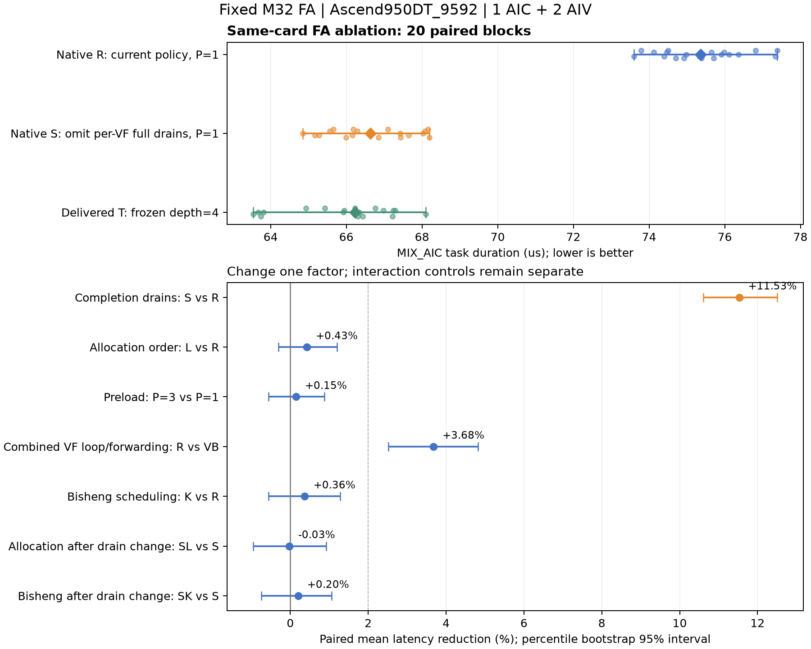

# 固定 FA：原生链路与交付链路的差距定位

当前状态（2026-10-28）：SSH 已恢复；原实验在 10 月 27 日断线后正常完成。117 次 G3、180 个正式 profiler 样本及 9 次预热全部通过，完整原始数据已取回并独立重放。**主要差距来自逐 VF 的保守等待：S 相对 R 的配对平均时延降低 11.53%，95% 区间为 10.61%–12.50%，收回本轮原生与交付版绝对时延差距的 92.1%。** S 相对交付版仍平均慢 1.18%，不能称为完全追平。本轮只签收固定 FA 的同步策略收益，不签发 G4，也不修改默认策略。

## 要回答的问题

此前“原生版本慢 12.81%”来自两个完整编译链路各五次采样。这个结果说明存在差距，但不能说明差距来自 VF、同步、内存分配或 preload。本轮固定输入、设备和存储槽数，每次改变一个因素，并保留交互对照。

原生链路确实执行 PTOAS VF 实质融合、CV 调度、PlanMemory 和 InsertSync。PlanMemory 使用不复用地址的物理分配；本轮不搜索 multi-buffer 槽数。交付版作为独立参考，保留原有物理布局及 Bisheng fused 同步，不能把它称为原生 PlanMemory 对照。

## 固定条件

| 条件 | 值 |
|---|---|
| 源文件 | `flash_attention_serial_m32_vpto_baseline.pto` |
| SHA-256 | `3c67b7a42b05b7fa1dd705e38892a335dc336bd6f14e7c025a05340e4fa00e9b` |
| Q / KV / D | 128 / 1024 / 128；tile 32×128×128 |
| 类型与启动 | FP16 Q/K/V、FP32 O；1 AIC＋2 AIV |
| 实测设备 | `ptoas-a5-39` device 1；Ascend950DT_9592 |
| 工具链 | CANN 9.2.0 B091；Bisheng 15.0.5；LLVM 19.1.7 |
| 原生编译器 | `21d21fe09864d1ad6cfdf62d920f2622cc2ef576` |
| 冻结采样工具 | `c0828bd63c453cc5c95d112c24175834d3ade33c` |
| 九组包摘要 | `f2c08456427531140726055ff201d6affc5aebe8da9bad1c80b31e05e37035c8` |

ACL 探测通过；环境状态只记为 `ACL_RUNTIME_AVAILABLE`。当前没有 npu-smi 的温度、ECC 和完整占用遥测。所有候选保留在同一张卡，不混合另一台主机的数据。

180 份 profiler 元数据均记录 AIC/AIV 1650 MHz；这不是逐任务动态频率遥测。旧实验辅助脚本生成的 `manifest.env` 留有 PR target、unassigned device 和 unavailable source 模板值，不能作为实际执行身份。实际身份由冻结 acceptance matrix、编译命令、每次运行的 DT SOC 检查和原始 profiler 的 device 1 字段核定；原模板文件保留，不事后改写。

## 消融组的含义

| 组 | 相对 R 的改动 | 要检验的因素 |
|---|---|---|
| R | 原生 P=1、完整 VF 优化、逐 VF 保守等待、默认分配顺序 | 原生参考 |
| S | 去掉每次 VF 调用后的全流水等待；跨核通知前及返回前等待仍保留 | 保守同步的成本 |
| L | 改为按 Buffer 大小排序分配；存储不复用 | 两种布局的敏感性 |
| SL | S＋L | 同步与布局的交互 |
| P3 | preload 从迭代距离 P=1 改为 P=3 | 更深 preload 是否改善当前链路 |
| VB | 保留相同 VF 候选，关闭 VMI loop fusion 与 load/store elision | 两项 VF 优化的合计效果 |
| K | 开启 Bisheng Vector 指令调度，保持 VPTO 调度关闭 | 后端指令调度 |
| SK | S＋K | 同步与后端指令调度的交互 |
| T | 冻结的同事交付版 depth=4 二进制 | 完整交付链路参考 |

原生 P 和交付版 depth 采用不同定义，不能逐个数字对应。P3 只用于本图上的更深预发射对照。

所有原生组都使用 PTOAS InsertSync 和 vecscope barrier，不叠加 Bisheng VF auto-sync。K 使用 `--bisheng-vec-misched=auto`，不是 `--vpto-scheduler=on`。后者会改变 VF 指令体，第一次试建已被结构一致性检查拒绝，没有送板。

## 已确认的结构变化

S 与 R 的规范化 VF 指令体、物理布局和物理访问序列相同。S 每个 AIV 少 424 条 BAR.ALL 及对应的 424 条 DCCI；跨核通知前和返回前的全流水等待保留。R 的 Vector 静态 BAR.ALL / DCCI 为 522 / 523，S 为 98 / 99。

这批额外等待来自固定 FA 兼容导入器的 `pto.cv.drain_stage_events` 要求，由 CVSchedule 插入。因此，这是受限验证链路的保守完成策略问题，不能直接归结为通用 InsertSync 错误，也不能据此说 PlanMemory 没有启用。

L 只改变布局，VF 指令体与外层操作数量保持一致。K 与 R、SK 与 S 的最终物理 IR 和布局分别一致，差异位于 Bisheng 后端调度选项。原生各组的 UB 高水位均为每 AIV 72,704 字节；两个 AIV 分域核算。布局对照只能比较本轮两种布局，不能排除其他布局的 bank 效应。

新的 R 与此前模型先选 P=1 的程序，在规范化符号和来源信息后，程序语义与物理布局一致。此次定位没有替换原生参考算法。

## G2 与 G3 证据

针对最终静态程序，独立检查器建立按硬件 pipe 排序的依赖图，使用 pipe FIFO、local set/wait、跨核 set/wait 和 PIPE_ALL 完成边。它不把线性 IR 顺序或模型预测完成时间当作安全证明。

八个原生性能候选通过了外层 RAW/WAR/WAW、flag 代际、边界和输出完成检查。该检查依赖编译器提供正确的 VF 内部语义，不能签发任意 VF 指令体的正确性证明。

九组新 G3 使用 zero、one_v、one_qkv 和三个 pattern seed，覆盖候选先执行及相反顺序。117/117 次通过。独立本地重放核对 833 个文件摘要、54 组独立 NumPy FP64 golden，最大绝对误差为 `7.950494147031945e-6`；输入与 guard 检查通过。

另一个中间配置 VC（loop fusion 开启、load/store elision 关闭）数值失败，已在采集性能前排除。seed 12345 有 16,281 个不匹配元素，最大误差 0.07328817；第二个 pattern seed 也失败，但全 1 输入通过。原始失败实验、重复复现和排除依据均保留。因此，本轮只能给出 VB/R 的合计 VF 效果，不能分别签收 loop fusion 与 elision 的贡献。

VC 的 scale→exp helper 存在同地址 VSTS→VLDS 且没有内部 memory barrier。这是目前有指令证据支持的嫌疑点；尚未用修复后的 kernel 验证，不能写成已证明的唯一根因。默认完整 VF 配置 R 在相同输入上通过。

## 性能统计和签收口径

独立性能实验 `20261027-fa-route-gap-perf-r2-c0828bd63` 已完成九次预热、20 个配对 block，共 180 个正式 profiler 样本。每个 block 使用相同 seed，九组执行顺序轮换并反向；每次恢复输入、校验输出，恰好一个匹配符号的 MIX_AIC task。原任务编号恢复后显示 not_found，但原报告、全部原始 profiler 和执行前后 ACL 探测均完整保留；没有重新测量或补样。

统计使用逐 block 的 `1-new/base`，10,000 次配对 bootstrap，随机种子 20260916，线性百分位 95% 区间。收益签收要求平均降低至少 2%、区间下界大于 0，且任何配对回退不超过 2%。必须重放全部原始 profiler，不能用终端中的部分采样代替结果。

S/R 用于归因保守等待；L/R 与 SL/S 用于布局及其交互；P3/R 用于 preload；K/R 与 SK/S 用于后端调度；R/VB 用于两项 VF 优化的合计效果。R−T、R−S 和 S−T 用配对绝对微秒差核对，不相加不同分母的收益百分比。S/T 用于报告剩余差距，不先把剩余部分归因给 VF。

| 组 | 中位时延（µs） | 范围（µs） | 正式样本 |
|---|---:|---:|---:|
| R | 75.3610 | 73.605–77.384 | 20 |
| S | 66.6335 | 64.855–68.199 | 20 |
| L | 75.0295 | 73.558–77.029 | 20 |
| SL | 66.6795 | 64.626–69.008 | 20 |
| P3 | 75.2495 | 73.998–77.662 | 20 |
| VB | 78.0910 | 76.622–80.571 | 20 |
| K | 75.0080 | 72.905–77.341 | 20 |
| SK | 66.1115 | 64.548–69.356 | 20 |
| T | 66.2315 | 63.536–68.103 | 20 |

下表收益均为配对均值，不用中位数相除代替；正值表示变体更快。

| 对照 | 平均时延降低 | 95% 区间 | 预设收益门 |
|---|---:|---:|---|
| S / R：移除逐 VF 全等待 | **11.53%** | **10.61%–12.50%** | **通过**，每对至少改善 8.52% |
| L / R：分配顺序 | 0.43% | −0.31%–1.20% | 未通过 |
| SL / S：同步改动后换布局 | −0.03% | −0.96%–0.92% | 未通过 |
| P3 / R：加深 preload | 0.15% | −0.56%–0.88% | 未通过 |
| R / VB：VF loop＋forwarding 合计 | **3.68%** | **2.52%–4.83%** | **通过** |
| K / R：Bisheng 指令调度 | 0.36% | −0.56%–1.28% | 未通过 |
| SK / S：同步改动后开后端调度 | 0.20% | −0.75%–1.06% | 未通过 |
| SL / L：另一布局下移除全等待 | **11.14%** | **10.30%–12.05%** | **通过** |
| SK / K：后端调度开启时移除全等待 | **11.39%** | **10.49%–12.29%** | **通过** |

因此：本轮同步策略是主要因素，两个布局和两种后端调度配置下的对照均支持这一结论。完整 VF 优化本身有正收益，关闭它会变慢。两种分配顺序、P=1/P=3 以及 Bisheng 调度开关没有产生达到门槛的改善；这不排除未测试布局或其他 preload 的作用，也不证明任意程序都不需要它们。

本轮每个 block 的绝对微秒差满足：平均 `R−T = 9.4582 µs`，`R−S = 8.7081 µs`，`S−T = 0.7501 µs`，即收回 **92.07%** 的本轮完整链路差距。S/T 的配对结果为平均慢 **1.18%**，95% 区间 **0.09%–2.32%**，尚有小幅剩余差距。历史的 12.81% 与本轮统计不是同一批样本，不能机械相减。SK 的中位数更低，但 SK/S 未过收益门，不根据该中位数重新选择候选。

## 给 cost model 的反馈

另做只读诊断重放：使用原先冻结的 TileSim `c90374b1e4408888459c0ba5b8068de0d8e49492` 成本实现、相同 profile，以及精确匹配 VF 指令体和绑定的存档成本。R/S/P3/K/SK 的 71 种 VF 条件均能匹配；L/SL/VB 不用不同绑定的旧成本冒充已知成本。

| 诊断组 | 原参数重放时延（µs） |
|---|---:|
| R | 72.270584 |
| S | 72.268917 |
| P3 | 72.272806 |
| K | 72.270584 |
| SK | 72.268917 |

R→S 的预测降低仅约 0.0023%。源代码显示，`NativeEvents.add` 给连续同核事件添加 SYNC predecessor，而 evaluator 用 predecessor 的结束时间决定后继就绪。这会把很多发射顺序变成完成等待，无法区分“先发射”和“等到完成再发射”。Bisheng 调度开关也没有进入复用的 VF 成本条件，不能据此假设它实际没有影响。

这份诊断在板端采样开始后生成，明确标为 `evaluation_only`、`preselection_prediction=false`、`G4_usable=false`；它不生成推荐，不改动冻结候选，也不是新的性能认证。时序参数仍是 950PR_9599 代理，实际设备为 950DT_9592。不能使用本轮验收样本反向调常数后再把同一批样本当作独立验证。

对本轮中位时延，R 的诊断预测误差为 −4.10%，S 为 +8.46%；两者分别低于 10% 并不能证明模型理解了优化机制。模型给出的 R→S 收益约 0.0023%，实测为 11.53%，低估约 **11.53 个百分点**。应改进发射/完成依赖和等待建模，而不是只用一个全局倍率对齐绝对时延。

## 下一步改动与边界

1. **已完成**原任务完整样本取回、180 份原始 profiler 重放、54 组独立 golden 和逐因素统计，没有补样或重测。
2. **已通过** S/R 收益门，保留受限范围的显式 `--cv-drain-vf-calls=false` 优化入口；继续完成通用完成条件证明和回归后，再考虑默认启用。普通 pipeline 和现有协议默认行为保持不变。
3. 修复并验证 VC 暴露的 VF 内部访存完成问题，补充 loop fusion 开启且 forwarding 关闭的数值回归。该问题当前阻止广泛 VF 正确性签收。
4. 编译器导出区分发射顺序、资源 FIFO、数据完成依赖及 barrier 作用域。TileSim 按这些语义建图；版本、完成策略和后端调度条件进入请求身份及成本复用条件。
5. 用独立原语实验校核等待及 cache maintenance 成本；补齐 DT 参数。随后冻结新模型，在新的留出实验中验证排名与时延误差。
6. 若 S/T 仍有稳定差距，再单独试验跨核通知处按 pipe 完成及 VF 调用/ABI 粒度。静态 CALL 或 spill 数量只用于提出假设，不用于分配未经实测的收益份额。

本轮不修改模型 Plan 的物理地址权限，不启用通用地址复用，不增加用户 annotation，不签发 G4，不扩大到真实 FA 全范围或其他目标。
